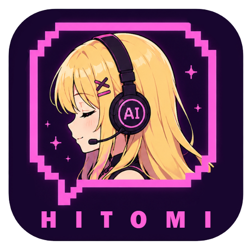
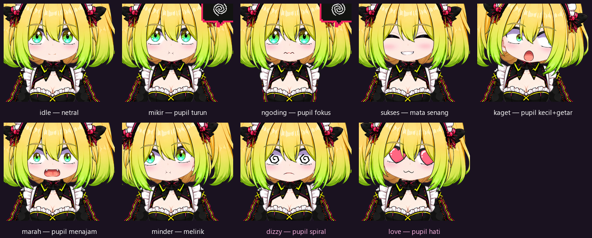

<div align="center">



# Hitomi-Live for Linux

A floating desktop avatar that reacts to your Claude Code sessions.


</div>

> *"Sayang, aku lagi mikirin promptmu~ jangan buru-buru ya. 💭"*
>
> Hitomi, watching your cursor while a tool runs.

Hitomi is a transparent, animated avatar that sits on top of your desktop. When you send Claude Code a
prompt she starts thinking, while a tool runs she gets to work, and when a task finishes she smiles and
shows her last sentence in a speech bubble. Errors make her dizzy; a run of them makes her angry.

All of it comes from Claude Code hooks and the session transcript, so she costs no extra tokens and
needs no text-to-speech. Start her once and she reacts in every project.

This is the Linux port of [Hitomi-Live](https://github.com/moncrath/Hitomi-Live), which ships as a
portable Windows `.exe` built with Tauri. On Linux she runs in Electron instead. Tauri uses the
system's WebKitGTK there, and on some setups (WebKitGTK 2.52 with recent NVIDIA drivers, in our case)
that engine never draws a single frame. Electron brings its own Chromium, so the system engine doesn't
matter.

## Requirements

- Linux with an X server, or Wayland with XWayland. Tested on KDE Plasma (Wayland) with an NVIDIA GPU.
- [Node.js](https://nodejs.org) and npm. npm installs and builds the app; Node is also what Claude Code
  uses to run Hitomi's hook.
- [Claude Code](https://claude.com/claude-code), in the terminal, the desktop app or an IDE extension.
  The hook is global, so any of them works.

## Run it

```bash
npm --prefix app install && npm --prefix app run build
npm --prefix electron install
npm --prefix electron start
```

On first start Hitomi installs her own hook. She writes `~/.claude/hooks/hitomi-notify.mjs` and
registers six events in `~/.claude/settings.json` (or under `$CLAUDE_CONFIG_DIR` if you set it). She
only adds her own entries: your permissions, model and other hooks stay as they are, and the original
file is copied to `settings.json.bak` before the first change. If the file can't be parsed, she leaves
it alone. A speech bubble tells you when the hook was just installed, or when Node.js is missing.

Claude Code may only pick up a new hook in a new session.

## Using her

- **Move:** drag her body.
- **Menu:** the arrow above her head. It sets her size (1 to 10), which side the speech bubble appears
  on, and quits.
- **Click-through:** the circle next to the arrow. Purple means off; green means clicks pass through her
  to whatever is behind. While it's green, the circle is the only part of her that still takes clicks,
  so click it again to get her back.
- **Tray icon:** the same click-through toggle and a quit item. On KDE it may sit behind the `^` in the
  system tray.

## What she reacts to

Expressions come from her pupils instead of swapped eye images, so she keeps looking at your cursor
while she reacts. Scale, offset, jitter, spin and pulse are procedural and set per state in the
manifest; only the heart and spiral pupils are drawn.



| State | Trigger | Pupils |
|---|---|---|
| `idle` | nothing happening | normal, tracking your cursor |
| `mikir` | you submit a prompt | slightly smaller, looking up |
| `ngoding` | a tool is running | slightly wider, and her hands shift pose |
| `sukses` | a task finished | happy closed eyes |
| `error` | a tool failed | shrunk and trembling |
| `marah` | 3 or more failures in a row | narrowed, looking down |
| `minder` | Node.js is missing | glancing away |
| `dizzy` | a single tool error | spiral pupils, spinning |
| `love` | session start | heart pupils, enlarged and pulsing |

She also blinks, breathes, tilts her head toward your cursor, and her hair swings on second-order
springs with mesh bending, so the tips lag behind the roots.

## How it works

```
Claude Code hook ──► notify.mjs ──► bridge inside the app (127.0.0.1:17872) ──► overlay (pixi.js)
```

The hook sends only an event name, or on `Stop` the last sentence from the transcript. The bridge
validates both strictly and never executes anything. It runs inside the Electron main process, so
there's no separate server to start.

## Known limits

- She runs through XWayland (`npm start` passes `--ozone-platform=x11`), because native Wayland won't
  let an app read the global cursor position or place its own window. While your cursor is over a
  native Wayland window, her eyes keep the last position they saw.
- There's no AppImage or `.deb` yet. Run her from source as above.

## The persona

[`CLAUDE.md`](CLAUDE.md) is the Hitomi persona plus the engineering rules she works by: security, git
etiquette, documentation discipline and the gates for UI work. Copy it into any project's root and
Claude Code loads it automatically. The avatar works with or without it.

## Repo contents

```
app/        pixi.js renderer (TypeScript), plus the Tauri shell used by the Windows build
electron/   the Linux shell: window, tray, hook bridge, hook installer
hooks/      notify.mjs, the hook that posts Claude Code events to the bridge
assets/     the avatar layers, UI images and the Itim font
scripts/    check-skins.mjs, a skin completeness check
docs/       Master State and Decision Log
CLAUDE.md   the persona and engineering ruleset
```

## License and credits

The code is under the [MIT License](LICENSE). The artwork is not: the Hitomi character, the UI images
and the app icons are all rights reserved (see [`assets/LICENSE`](assets/LICENSE)).

Hitomi is an original character. Her concept and design are the author's own; the artwork was rendered
with AI assistance (ChatGPT) and then split into layers, pivoted and rigged by hand. Images that are
purely AI-rendered may not qualify for copyright protection in some jurisdictions.

The menu and speech bubble use [Itim](https://fonts.google.com/specimen/Itim) by Cadson Demak, under
the SIL Open Font License 1.1 ([`assets/ui/OFL-Itim.txt`](assets/ui/OFL-Itim.txt)).
